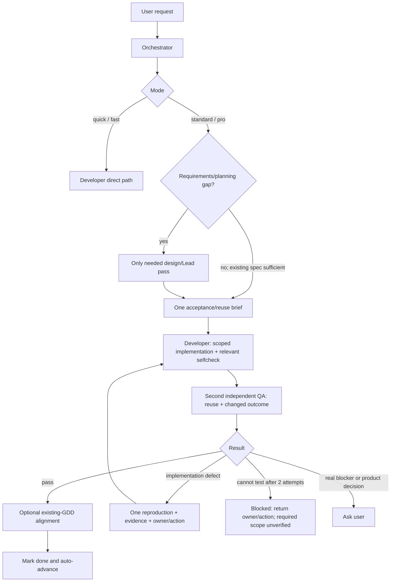

# Unity Game Agent


Autonomous Unity game development skill for Claude Code, Codex, Cursor, and other AI coding agents: from an idea or existing project task to implemented, documented, and verified Unity work.

The pipeline uses scoped task ownership, Unity preflight, reuse gates, independent player QA and bounded correction loops.

**Prime rule: prove reuse before implementation.** Nontrivial work searches the project, installed
NeoTools, compatible licensed assets/libraries and allowed ready-project slices. The brief records
source/license/version/fit; QA checks actual integration. Custom requires demonstrated misses/poor fit
and a narrower/faster rationale, or explicit from-scratch intent. A clone beside homemade code is not reuse.

```text
Existing sufficient TZ/GDD -> one brief -> Developer -> independent QA -> SHIP
                                            ^              |
                                            +-- correction-+
```

## Why It Exists

Most Unity agents can write scripts. That is not the hard part.

The hard part is staying aligned with an existing project, not rewriting working systems, testing gameplay instead of claiming it works, tracking state across sessions, and moving forward when tools fail.

Unity Game Agent is built for that gap.

## What Makes It Different

| Capability | Generic coding agent | Basic Unity skill | Unity Game Agent |
|---|---:|---:|---:|
| Reads existing architecture before changing it | Sometimes | Sometimes | Required |
| Reuse-first search before custom code | Rare | Partial | Required |
| Game design pass | No | No | Only for gaps; optional alignment after QA |
| UI/UX and visual design pass | No | Partial | Only for unresolved visual design |
| Planning record | No | Rare | One acceptance/reuse brief; Lead only for gaps |
| One task per developer pass | No | Rare | Required |
| Independent QA pass | No | Partial | Second QA subagent, same brief's QA section |
| Parallel isolated Unity Editors | Manual | Rare | Worktree + own Library/Editor/MCP; pro default for concurrent Unity tasks |
| Resource-aware parallel tests | Manual | Rare | Library cloning, disk/RAM gates, headless runs, shared-source test clones |
| Play Mode verification policy | Weak | Partial | Required by mode |
| EditMode/PlayMode test expectations | Optional | Optional | Declared per task/feature |
| Screenshot evidence and visual review | Optional | Partial | Required for visual/runtime-visible work |
| Interactive checks cannot pass from screenshots alone | Rare | Rare | Required |
| Failure recovery without infinite retry loops | Rare | Rare | At most 2 failures -> concise owner/action blocker |
| Persistent project state | Manual | Partial | Docs/DEV_STATE, DEV_LOG, DEV_PLAN |
| Skill self-improvement memory | No | No | SKILL_MEMORY.md |

## Pipeline



## Role System

The orchestrator stays accountable, but work is split into small role files so the agent does not keep every responsibility in one context.

| Role | Goal | Main output |
|---|---|---|
| Game Designer | Turn idea or vague gameplay into implementable design | `Docs/GAME_DESIGN.md` |
| Designer | Define UI/UX, visual direction, states, assets, and visual QA | `Docs/UI_BRIEF.md` |
| Lead | Resolve real scope/ownership/acceptance gaps | One brief and necessary plan links |
| Developer | Implement the scoped brief with suitable ready systems | Source-final files plus Developer handoff section |
| QA | Independently verify actual reuse and player outcome | Same brief's QA result/defects/evidence |

In `standard` and `pro`, use one Developer and a second independent QA when available and allowed;
reuse them through corrections. Design/Lead passes are conditional. If delegation is unavailable,
disclose local role switching and missing independent QA. One operator per workspace serializes Unity;
isolated workspaces may run concurrently (pro default for 2+ Unity-bound tasks, standard opt-in, fast off).
See [parallel Unity Editors](tools/parallel-editors.md). Source-final
handoff precedes import/compile/player checks. After fixes, rerun failed/affected checks and cite valid
unaffected evidence with source revision/scope/environment.

## Development Patterns

The pipeline is the engine; a **development pattern** is a swappable playbook for one *family* of games.
A pattern fills the same pipeline with concrete stack choices, scene skeletons, reuse maps, golden rules,
and anti-patterns — and is auto-selected by detecting the project (packages, namespaces, scene shape) or
matching the request for a new project.

| Pattern | Use for | Stack |
|---|---|---|
| `casual-neoxider` | Casual / hyper-casual / mobile: match-3, merge, lotto/bingo, slots, dress-up, idle/clicker, arcade, puzzle | NeoxiderTools (`Neo.*`) + NeoxiderPages + DOTween via Unity MCP |

Patterns are additive — drop a new `patterns/<name>/pattern.md` and register it. See
[patterns/README.md](patterns/README.md).

## Current Progress

These are implemented in the skill today.

| Area | Status | Evidence |
|---|---:|---|
| Runtime policy profile | Done | `templates/DEV_PROFILE.json` |
| Development patterns | Done | `patterns/README.md` |
| casual-neoxider pattern | Done | `patterns/casual-neoxider/` |
| UI Toolkit profile (6.5 / PanelRenderer) | Done | `project-profiles/ui-toolkit/` |
| uGUI adaptivity canon (Expand + safe area) | Done | `project-profiles/plain-ugui.md` |
| Pre-vetted uGUI effect packages before custom code | Done | `project-profiles/plain-ugui.md`, `tools/libraries-setup.md` |
| Fast / standard / pro mode matrix | Done | `POLICY_MATRIX.md`, `modes/` |
| Parallel Unity workspace isolation | Done | [Guide](tools/parallel-editors.md), [PowerShell helper](tools/unity-workspace.ps1) |
| Reuse-first discovery policy | Done | `SKILL.md`, `tools/libraries-setup.md` |
| Role subskills | Done | `roles/game-designer.md`, `roles/designer.md`, `roles/lead.md`, `roles/developer.md`, `roles/qa.md` |
| Standard/pro feature docs | Done | `templates/FEATURE.md`, `templates/TASK.md` |
| Compact independent QA; legacy expanded docs | Done | `templates/FEATURE.md`, legacy QA templates |
| Play Mode QA automation policy | Done | `tools/playmode-qa-automation.md` |
| EditMode/PlayMode test expectations | Done | Feature/task verification fields |
| Screenshot evidence policy | Done | QA templates and Play Mode QA reference |
| Trustworthy UI capture (Device Simulator) | Done | `tools/ui-screenshot-truth.md` |
| Tester-agent QA rounds, editor hygiene | Done | `tools/playmode-qa-automation.md`, `roles/qa.md` |
| Input System, Android Back, real-input QA driving | Done | `tools/input-system.md` |
| UI motion, reveal order, monetisation priority, reward flights | Done | `tools/ui-motion-and-monetization.md` |
| Shaders and VFX (libraries, UI shader checklist) | Done | `tools/shaders-and-vfx.md` |
| Audio generation, import, background/ad pause | Done | `tools/audio.md` |
| Mobile build size (ASTC, sprite atlases, APK) | Done | `tools/mobile-build-and-size.md` |
| Meta progress map over painted art | Done | `tools/meta-progress-map.md` |
| Two-attempt QA failure recovery | Done | `qa_max_attempts_before_degraded_report: 2` |
| Skill memory | Done | `SKILL_MEMORY.md`, `tools/append-skill-memory.ps1` |
| Project bootstrap | Done | `setup_project.bat` |
| Feature doc generator | Done | `tools/new-feature-docs.ps1` |
| Skill validation | Done | `tools/validate-skill.ps1` |
| Script smoke tests | Done | `tools/test-scripts.ps1` |

## Verification Philosophy

The skill treats "it compiles" as a start, not a finish.

For Unity work, the close gate can include:

- compile/import readiness;
- console baseline and current console comparison;
- Play Mode run;
- console checks during Play Mode;
- declared runtime driver;
- EditMode tests;
- PlayMode tests;
- screenshot capture and visual review;
- task evidence in docs;
- independent QA result.

Interactive gameplay, UI flows, input, collision, spawning, scene transitions, pause, restart and
runtime state changes need an actual driven outcome. A screenshot or degraded report cannot pass them;
unexecuted required scope stays blocked.

## Bounded QA Recovery

QA should be strict, but it should not freeze the whole project.

Rule:

```text
2 serious attempts per required QA check.
If still blocked: return a concise blocker to Developer/operator; required scope stays unverified.
```

The degraded report must include:

- what was attempted;
- exact failure reason;
- skipped checks;
- available evidence;
- player/user risk;
- next owner/action (a follow-up task only when existing tracking needs it).

Unrelated safe work may continue. Missing/empty/unsupported required checks cannot pass; do not start
another harness or metadata-audit loop to avoid the limit.

## Modes

| Mode | Use for | Cadence |
|---|---|---|
| fast | Prototype, small playable slice, quick validation | Larger feature batches, lighter docs |
| standard | Complete small game or meaningful feature work | One brief, changed-outcome independent QA |
| pro | Long-lived/high-risk work | Same compact loop, justified contract/platform evidence |

## Project Records

For a direct tracked item, reuse sufficient requirements and one task/feature brief. The generator
creates `Docs/Features/FEAT-*.md` by default, with inline tasks, Developer handoff and QA-owned result.
Independent QA does not require new QA/QA_AGENT/log trees. Full-pipeline resources below are created
only as needed; existing project docs remain readable without migration.

```text
Docs/
  DEV_CONFIG.md
  DEV_PROFILE.json
  GAME_DESIGN.md
  UI_BRIEF.md
  DEV_STATE.md
  DEV_PLAN.md
  AGENT_MEMORY.md
  ARCHITECTURE.md
  DEV_LOG/
  Screenshots/
  Features/
  Tasks/
  QA/
  QA_AGENT/
```

Use `-DetailedTracking` for explicit separate Task/QA output. Legacy `-CreateIndependentQa` still
requests expanded output plus a QA_AGENT duplicate; existing files are never overwritten. This flag
controls document output, not whether a QA agent runs.

## Quick Start

1. Put this folder in your agent's skills location (e.g. `~/.claude/skills/unity-game-agent`, `~/.codex/skills/unity-game-agent`, or `.cursor/skills/unity-game-agent`).
2. Open a Unity project or create an empty project.
3. Ask for a quick fix, a direct feature, or a full game.
4. The skill chooses the shortest verified path:
   - quick fix for narrow edits;
   - fast for prototypes;
   - standard for complete small games/features;
   - pro for stricter architecture and tests.

Optional bootstrap for tracked projects:

```powershell
.\setup_project.bat "<UnityProjectRoot>"
```

## MCP And Unity Automation

The skill is provider-neutral. `mcp-commands.md` covers only installing/enabling the default
CoplayDev adapter; tool usage comes from the live MCP tool schemas (and the dedicated `unity-mcp-skill`
when installed), not from a static catalog.

It expects the agent to prefer MCP/Editor automation when available:

- inspect editor state;
- wait for compile/import/domain reload;
- read console;
- run tests;
- enter Play Mode;
- capture screenshots;
- save scenes;
- run builds when relevant.

If MCP is unavailable, the skill falls back to CLI/file-level work only where safe, records degraded verification, and avoids pretending runtime behavior was tested.

## Honest Limits

This skill does not make Unity verification magically perfect. Some projects still need custom QA hooks, deterministic seeds, test scenes, or input drivers.

The difference is that the skill forces those gaps to become visible tasks instead of hidden assumptions.

## Best Fit

Use Unity Game Agent when you want:

- a real Unity project workflow, not one-shot script generation;
- autonomous progress with documented state;
- feature-by-feature delivery;
- QA evidence;
- reusable libraries and references before custom code;
- a system that can resume work across sessions.

For a one-line script edit, use quick mode. For a game or feature that should survive more than one session, use standard or pro.
