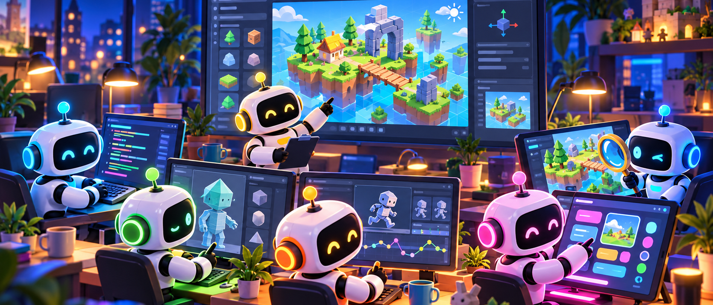
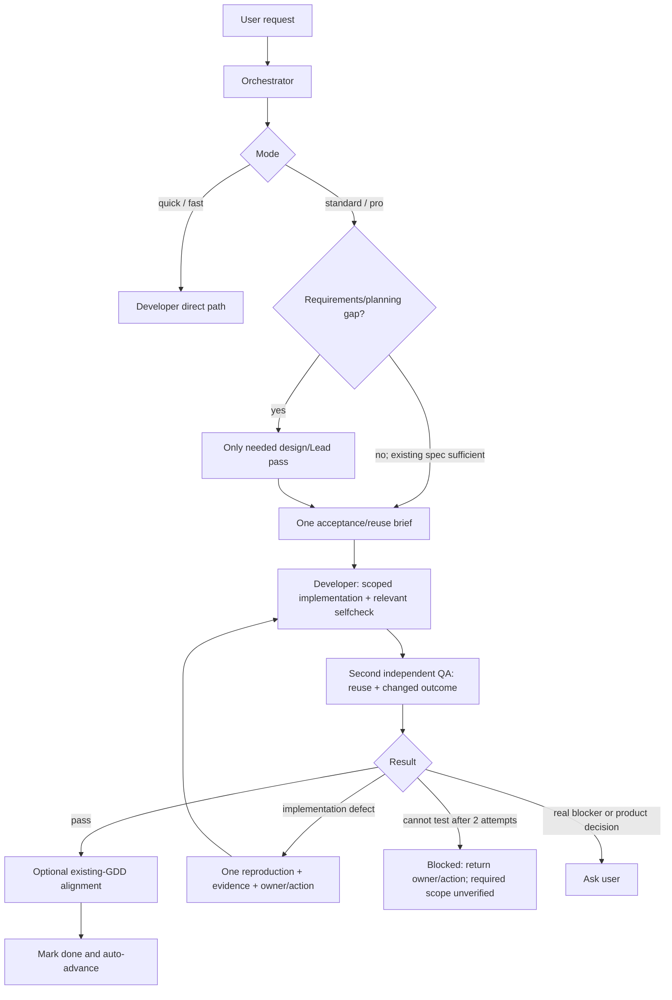
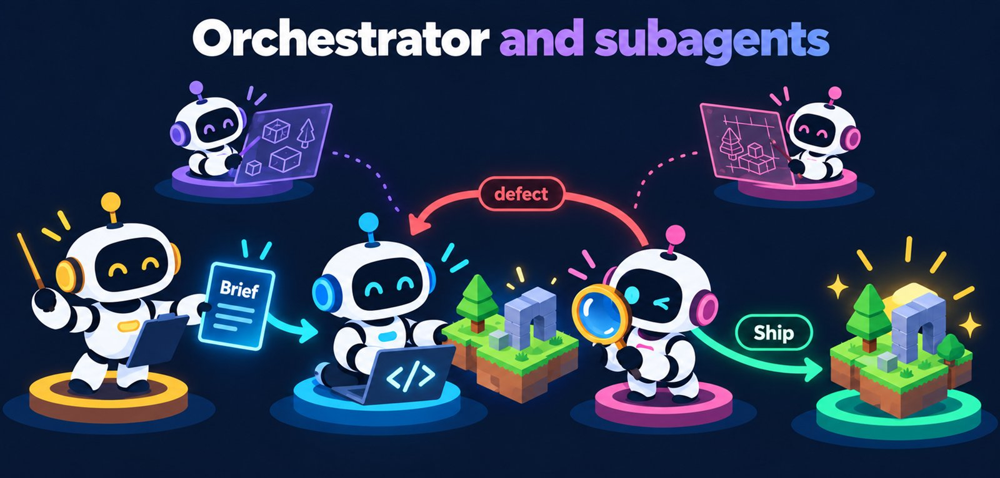
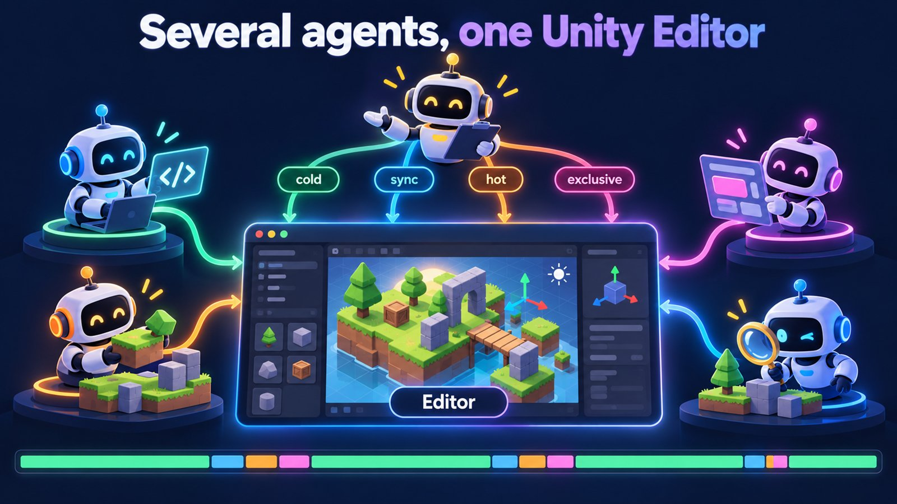
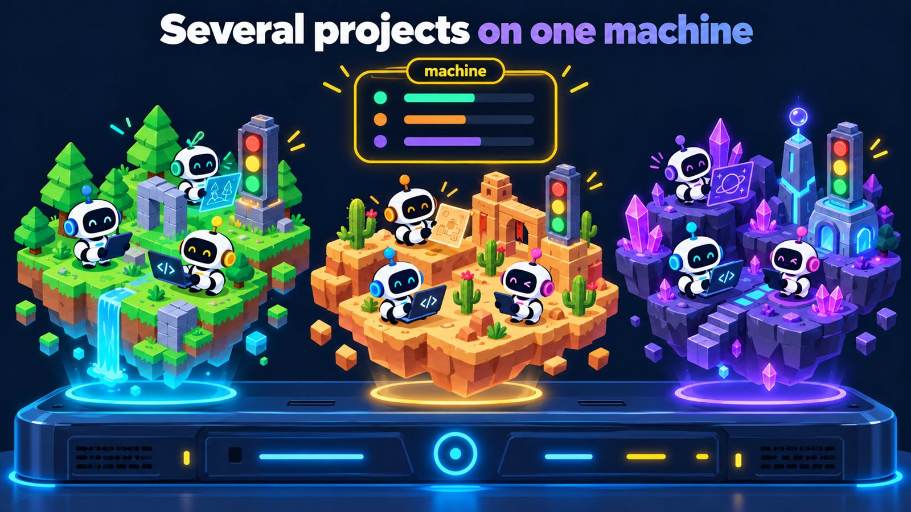
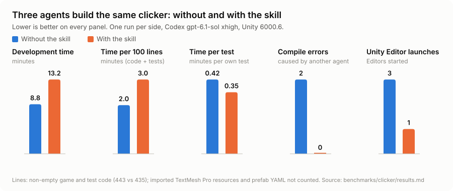

# Unity Game Agent



A Unity game development skill for Claude Code, Codex, Cursor and other AI coding agents. It takes an idea or an existing project task and carries it through to implemented, documented and verified Unity work.

The pipeline gives each task one owner, runs a Unity preflight, checks reuse before new code, has an independent QA agent check what the player actually gets, and caps correction loops.

**Prime rule: prove reuse before implementation.** For nontrivial work, search the project, the
installed NeoTools, compatible licensed assets and libraries, and allowed ready-project slices. The
brief records source, license, version and fit; QA checks the actual integration. Writing custom code
requires demonstrated misses or a poor fit plus a narrower, faster rationale, or an explicit
from-scratch intent. A clone sitting next to homemade code is not reuse.

```text
Existing sufficient TZ/GDD -> one brief -> Developer -> independent QA -> SHIP
                                            ^              |
                                            +-- correction-+
```

## Why It Exists

Most Unity agents can write scripts. That is not the hard part.

The hard part is staying aligned with an existing project. That means not rewriting working systems, testing gameplay instead of claiming it works, keeping state across sessions, and moving forward when tools fail.

That is the gap this skill fills.

## What Makes It Different

| Capability | Generic coding agent | Basic Unity skill | Unity Game Agent |
|---|---:|---:|---:|
| Reads existing architecture before changing it | Sometimes | Sometimes | Required |
| Reuse-first search before custom code | Rare | Partial | Required |
| Game design pass | No | No | Only for gaps; optional alignment after QA |
| UI/UX and visual design pass | No | Partial | Only for unresolved visual design |
| Planning record | No | Rare | One acceptance/reuse brief; Lead only for gaps |
| One task per developer pass | No | Rare | Required |
| Independent QA pass | No | Partial | Second QA subagent, same brief's QA section |
| Several agents in one Unity Editor | Manual | Rare | Broker package: leases, one batched import/compile, batched tests and Play Mode, exclusive windows, live board |
| Several projects on one machine | Manual | Rare | Independent broker per project, machine-wide registry, shared Editor preferences reference-counted |
| Several Editors at once, on request | Manual | Rare | Opt-in: you ask, or the agent proposes and you accept; worktree + own Library/Editor/MCP per Editor, disk/RAM gates, headless runs |
| Play Mode verification policy | Weak | Partial | Required by mode |
| EditMode/PlayMode test expectations | Optional | Optional | Declared per task/feature |
| Screenshot evidence and visual review | Optional | Partial | Required for visual/runtime-visible work |
| Interactive checks cannot pass from screenshots alone | Rare | Rare | Required |
| Failure recovery without infinite retry loops | Rare | Rare | At most 2 failures -> concise owner/action blocker |
| Persistent project state | Manual | Partial | Docs/DEV_STATE, DEV_LOG, DEV_PLAN |
| Skill self-improvement memory | No | No | SKILL_MEMORY.md |

## Pipeline



## Role System

The orchestrator stays accountable, but the work is split into small role files so one agent does not hold every responsibility in a single context.



Detailed diagram: [brief, Developer, independent QA and the defect loop](assets/diagram-agent-pipeline.svg).

| Role | Goal | Main output |
|---|---|---|
| Game Designer | Turn idea or vague gameplay into implementable design | `Docs/GAME_DESIGN.md` |
| Designer | Define UI/UX, visual direction, states, assets, and visual QA | `Docs/UI_BRIEF.md` |
| Lead | Resolve real scope/ownership/acceptance gaps | One brief and necessary plan links |
| Developer | Implement the scoped brief with suitable ready systems | Source-final files plus Developer handoff section |
| QA | Independently verify actual reuse and player outcome | Same brief's QA result/defects/evidence |

In `standard` and `pro`, use one Developer and a second, independent QA when that is available and
allowed, and keep them through corrections. Design and Lead passes are conditional. If delegation is
not available, say so: the agent switches roles locally and there is no independent QA. The
source-final handoff comes before import, compile and player checks. After a fix, rerun the failed or
affected checks. For checks you did not rerun, cite evidence that is still valid, with source
revision, scope and environment.

## Several Agents, One Unity Editor

Cloning a Unity project for each agent costs a Library and an Editor per clone, and the branches
collide on one machine. Instead, every agent works **in the same project, branch and Editor**. An
Editor-only broker package (Unity 6+) schedules the Editor as a shared resource.



Detailed diagram: [leases, lanes and the Editor timeline](assets/diagram-shared-editor.svg).

- **Order of operations:** cold work always wins. Staged scripts and heavy imports from every agent are
  compiled together. Tests and Play Mode run batched, at the end. One agent at a time gets the whole
  Editor for packages or builds.
- **Compile errors find their author:** the agent that broke the build gets `failed` with the errors.
  Everyone else gets `blocked` instead of a failure with no explanation.
- **Background waiting:** an agent with nothing else to do waits on its window as a background task.
- **Both adapters:** rules for MCP for Unity (CoplayDev) and the Unity CLI (Pipeline package), with an
  `uga_broker` command for each.
- **Several projects on one machine** stay independent. `editor-broker.ps1 projects` lists them all.
- **Telemetry per project:** `editor-broker.ps1 stats` shows how long each agent waits, how long the
  queue gets and how long windows take, for the current session and across past ones.
- **Agents know about each other:** `brief` shows the team, the queue with a rough ETA and new
  messages; `say` posts handoffs and API changes to a shared Markdown team board.



Detailed diagram: [per-project brokers and the machine registry](assets/diagram-multi-project.svg).

Start: `tools/editor-broker.ps1 doctor -Fix`, then `session start`. Protocol and adapter tables:
[tools/shared-editor.md](tools/shared-editor.md). Want two or more Editors at once (separate branches,
simultaneous Play Mode, a long test queue)? Ask for it, or accept the agent's proposal:
[several Editors at once](tools/parallel-editors.md).

### Measured: three agents build a clicker

Same small game (sized for 5-15 minutes), three Codex agents at once, one machine, run once each
([benchmark](benchmarks/clicker/README.md), [full results](benchmarks/clicker/results.md)):



| | Without the skill | With the skill |
|---|---|---|
| Compile errors caused by another agent | 2 | 0 |
| Unity Editor launches | 3 | 1 |
| Agents' own tests | 21 | 38 |
| Time per test | 0.42 min | 0.35 min |
| Development time | 8.8 min | 13.2 min (1.0 min of it orchestrator setup) |
| Code written (game + tests, non-empty lines) | 443 | 435 |
| Time per 100 lines | 2.0 min | 3.0 min |
| Hidden acceptance tests | 17 / 17 | 17 / 17 |
| Tokens | 2.05 M | 3.98 M (mostly cached input) |

Both teams wrote about the same amount of code, so per line the skill was slower here as well; per
test it was faster, because its team wrote 38 tests instead of 21.

This is a deliberately simple project, so the time win does not show here. The protocol's fixed costs
(reading the skill, waiting for windows) are as large as the work itself. What the run does show is the
cost of working without it: even three agents on a ten-minute game broke each other's build twice and
started three Editors. Each extra agent is one more writer that can break the shared build, lock the
project or take the Editor away. Without the skill, conflicts and waiting grow with the number of
agents, and development stretches out. The skill keeps every compile error with its author and the
whole team in one Editor.

## Development Patterns

The pipeline is the engine. A **development pattern** is a swappable playbook for one *family* of
games. It fills the same pipeline with concrete stack choices, scene skeletons, reuse maps, golden
rules and anti-patterns. The skill picks a pattern by detecting the project (packages, namespaces,
scene shape) or by matching the request for a new project.

| Pattern | Use for | Stack |
|---|---|---|
| `casual-neoxider` | Casual / hyper-casual / mobile: match-3, merge, lotto/bingo, slots, dress-up, idle/clicker, arcade, puzzle | NeoxiderTools (`Neo.*`) + NeoxiderPages + DOTween via Unity MCP |

Patterns are additive — drop a new `patterns/<name>/pattern.md` and register it. See
[patterns/README.md](patterns/README.md).

## Current Progress

These are implemented in the skill today.

| Area | Status | Evidence |
|---|---:|---|
| Runtime policy profile | Done | `templates/DEV_PROFILE.json` |
| Development patterns | Done | `patterns/README.md` |
| casual-neoxider pattern | Done | `patterns/casual-neoxider/` |
| UI Toolkit profile (6.5 / PanelRenderer) | Done | `project-profiles/ui-toolkit/` |
| uGUI adaptivity canon (Expand + safe area) | Done | `project-profiles/plain-ugui.md` |
| Pre-vetted uGUI effect packages before custom code | Done | `project-profiles/plain-ugui.md`, `tools/libraries-setup.md` |
| Fast / standard / pro mode matrix | Done | `POLICY_MATRIX.md`, `modes/` |
| Several agents in one Editor (broker, lanes, board) | Done | [Protocol](tools/shared-editor.md), [CLI](tools/editor-broker.ps1), [package](unity-package/README.md), CLI + EditMode + live Unity e2e tests |
| Several projects on one machine | Done | `editor-broker.ps1 projects`, machine registry, reference-counted Editor preferences |
| Shared-editor telemetry per project | Done | `editor-broker.ps1 stats`: wait per agent, queue length, window and drain times, session history |
| Team brief and board | Done | `editor-broker.ps1 brief` (roster, queue ETA, unread messages), `say` -> `Library/UgaBroker/team-board.md` |
| Several Editors at once (opt-in) | Done | [Guide](tools/parallel-editors.md), [PowerShell helper](tools/unity-workspace.ps1) |
| Reuse-first discovery policy | Done | `SKILL.md`, `tools/libraries-setup.md` |
| Role subskills | Done | `roles/game-designer.md`, `roles/designer.md`, `roles/lead.md`, `roles/developer.md`, `roles/qa.md` |
| Standard/pro feature docs | Done | `templates/FEATURE.md`, `templates/TASK.md` |
| Compact independent QA; legacy expanded docs | Done | `templates/FEATURE.md`, legacy QA templates |
| Play Mode QA automation policy | Done | `tools/playmode-qa-automation.md` |
| EditMode/PlayMode test expectations | Done | Feature/task verification fields |
| Screenshot evidence policy | Done | QA templates and Play Mode QA reference |
| Trustworthy UI capture (Device Simulator) | Done | `tools/ui-screenshot-truth.md` |
| Tester-agent QA rounds, editor hygiene | Done | `tools/playmode-qa-automation.md`, `roles/qa.md` |
| Input System, Android Back, real-input QA driving | Done | `tools/input-system.md` |
| UI motion, reveal order, monetisation priority, reward flights | Done | `tools/ui-motion-and-monetization.md` |
| Shaders and VFX (libraries, UI shader checklist) | Done | `tools/shaders-and-vfx.md` |
| Audio generation, import, background/ad pause | Done | `tools/audio.md` |
| Mobile build size (ASTC, sprite atlases, APK) | Done | `tools/mobile-build-and-size.md` |
| Meta progress map over painted art | Done | `tools/meta-progress-map.md` |
| Two-attempt QA failure recovery | Done | `qa_max_attempts_before_degraded_report: 2` |
| Skill memory | Done | `SKILL_MEMORY.md`, `tools/append-skill-memory.ps1` |
| Project bootstrap | Done | `setup_project.bat` |
| Feature doc generator | Done | `tools/new-feature-docs.ps1` |
| Skill validation | Done | `tools/validate-skill.ps1` |
| Script smoke tests | Done | `tools/test-scripts.ps1` |

## Verification Philosophy

The skill treats "it compiles" as a start, not a finish.

For Unity work, the close gate can include:

- compile/import readiness;
- console baseline and current console comparison;
- Play Mode run;
- console checks during Play Mode;
- declared runtime driver;
- EditMode tests;
- PlayMode tests;
- screenshot capture and visual review;
- task evidence in docs;
- independent QA result.

Interactive gameplay, UI flows, input, collision, spawning, scene transitions, pause, restart and
runtime state changes need an actual driven outcome. A screenshot or degraded report cannot pass them;
unexecuted required scope stays blocked.

## Bounded QA Recovery

QA should be strict, but it should not freeze the whole project.

Rule:

```text
2 serious attempts per required QA check.
If still blocked: return a concise blocker to Developer/operator; required scope stays unverified.
```

The degraded report must include:

- what was attempted;
- exact failure reason;
- skipped checks;
- available evidence;
- player/user risk;
- next owner/action (a follow-up task only when existing tracking needs it).

Unrelated safe work may continue. Missing, empty or unsupported required checks cannot pass. Do not
start another harness or metadata-audit loop just to dodge the limit.

## Modes

| Mode | Use for | Cadence |
|---|---|---|
| fast | Prototype, small playable slice, quick validation | Larger feature batches, lighter docs |
| standard | Complete small game or meaningful feature work | One brief, changed-outcome independent QA |
| pro | Long-lived/high-risk work | Same compact loop, justified contract/platform evidence |

## Project Records

For a direct tracked item, reuse sufficient requirements and one task/feature brief. The generator
creates `Docs/Features/FEAT-*.md` by default, with inline tasks, Developer handoff and QA-owned result.
Independent QA does not require new QA/QA_AGENT/log trees. Full-pipeline resources below are created
only as needed; existing project docs remain readable without migration.

```text
Docs/
  DEV_CONFIG.md
  DEV_PROFILE.json
  GAME_DESIGN.md
  UI_BRIEF.md
  DEV_STATE.md
  DEV_PLAN.md
  AGENT_MEMORY.md
  ARCHITECTURE.md
  DEV_LOG/
  Screenshots/
  Features/
  Tasks/
  QA/
  QA_AGENT/
```

Use `-DetailedTracking` for separate Task/QA output. The legacy `-CreateIndependentQa` flag still
requests expanded output plus a QA_AGENT duplicate; existing files are never overwritten. This flag
controls document output. It does not decide whether a QA agent runs.

## Quick Start

1. Put this folder in your agent's skills location (e.g. `~/.claude/skills/unity-game-agent`, `~/.codex/skills/unity-game-agent`, or `.cursor/skills/unity-game-agent`):
   `git clone https://github.com/NeoXider/unity-game-agent ~/.claude/skills/unity-game-agent`.
2. Open a Unity 6 project or create an empty one.
3. Ask for a quick fix, a direct feature, or a full game.
4. The skill chooses the shortest verified path:
   - quick fix for narrow edits;
   - fast for prototypes;
   - standard for complete small games/features;
   - pro for stricter architecture and tests.
5. Several agents on one project: the orchestrator runs
   `tools/editor-broker.ps1 doctor -ProjectRoot <project> -Fix` (installs the broker package into the
   project and applies the settings), then `session start -Agent lead`; see
   [tools/shared-editor.md](tools/shared-editor.md).

Optional bootstrap for tracked projects:

```powershell
.\setup_project.bat "<UnityProjectRoot>"
```

## MCP And Unity Automation

The skill is provider-neutral. `mcp-commands.md` covers only installing/enabling the default
CoplayDev adapter; tool usage comes from the live MCP tool schemas (and the dedicated `unity-mcp-skill`
when installed), not from a static catalog.

It expects the agent to prefer MCP/Editor automation when available:

- inspect editor state;
- wait for compile/import/domain reload;
- read console;
- run tests;
- enter Play Mode;
- capture screenshots;
- save scenes;
- run builds when relevant.

If MCP is unavailable, the skill falls back to CLI or file-level work, and only where that is safe. It records the verification as degraded and does not pretend runtime behavior was tested.

## Honest Limits

This skill does not make Unity verification perfect. Some projects still need custom QA hooks, deterministic seeds, test scenes or input drivers.

The difference is that the skill turns those gaps into visible tasks instead of leaving them as hidden assumptions.

## Best Fit

Use Unity Game Agent when you want:

- a real Unity project workflow, not one-shot script generation;
- autonomous progress with documented state;
- feature-by-feature delivery;
- QA evidence;
- reusable libraries and references before custom code;
- a system that can resume work across sessions.

For a one-line script edit, use quick mode. For a game or feature that should survive more than one session, use standard or pro.
