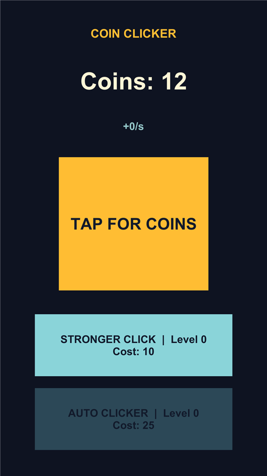
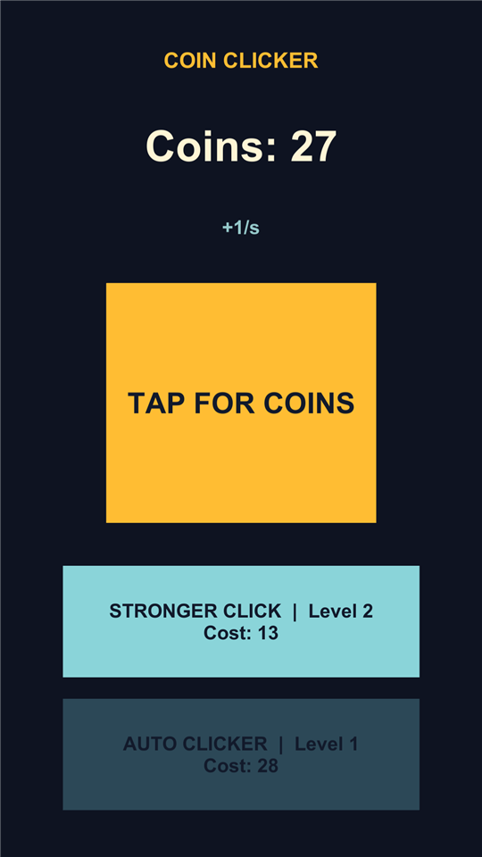

# Clicker benchmark results

Run on 2026-10-23, Windows 11, Unity 6000.6.0f1, one machine. Procedure and criteria:
[README.md](README.md). Both runs: three Codex CLI agents (`gpt-6.1-sol`, reasoning `xhigh`) working
at the same time (`core`, `ui`, `scene`), launched through neoxider-agents, one run after the other.
Run A was forbidden the skill, neoxider-agents and sub-agents; run B was asked to use the whole skill.

## Headline

| | Run A: no skill | Run B: with the skill |
|---|---|---|
| **Development time** (first orchestrator action to last agent's reply) | **8.8 min** | **13.2 min** |
| Of which orchestrator setup (broker install, Editor start, `doctor -Fix`, `session start`) | - | 1.0 min |
| Agents' own wall time (first agent start to last reply) | 8.8 min | 11.8 min |
| One-time skill reading per agent (runs in parallel) | - | 0.3-0.6 min |
| **Conflicts: compile errors caused by another agent** | **2** (`ui` and `scene` both compiled against a `Clicker.Core` that did not exist yet: `CS0234`, "Scripts have compiler errors") | **0** (3 of 3 sync windows passed) |
| Conflicts: project lock failures | 0 | 0 |
| Protocol violations on the broker board | - | 0 |
| Waiting reported by agents (self-reported) | 4.3 min (0.4 + 1.0 + 2.9) | 3.4 min (1.4 + 0 + 2.0) |
| "Blocked by another agent" (self-reported) | 4 | 5 (waits for windows, by design) |

On this game, sized for 5-15 minutes, the skill was **slower** (+4.4 min, +3.0 min without the
orchestrator setup) and removed the cross-agent compile breaks. Both teams shipped a game that passes
every acceptance check.

> **A very simple project.** The time win does not show on a game this small: the protocol's fixed
> costs (reading the skill, waiting for windows) are as large as the work itself. The conflicts are
> the part that scales. Each extra agent is one more writer that can break the shared build, lock the
> project or take the Editor away, so without the skill conflicts and mutual waiting grow with the
> number of agents and development stretches out; three agents on a ten-minute game already broke each
> other's build twice. This growth is the expected trend, not something this single run measured.

## Everything else

| # | Criterion | Run A | Run B |
|---|---|---|---|
| 1 | Agents | 3 (`core`, `ui`, `scene`), no sub-agents | 3 (`core`, `ui`, `scene`), no sub-agents |
| 2 | Per-agent time | core 4.2, ui 8.3, scene 5.6 min | core 4.8, ui 10.2, scene 11.7 min |
| 3 | Acceptance (hidden tests) | **17 / 17** | **17 / 17** |
| 4 | Agents' own tests | 21 / 21 (20 EditMode, 1 PlayMode) | 38 / 38 (37 EditMode, 1 PlayMode) |
| 5 | Fix rounds needed | 0 | 0 |
| 6 | Unity Editor launches | 3 (`scene` opened one shared batch Editor; `ui` opened two more after it exited; `core` used whichever was open) + 6 Unity CLI calls | 1 (the shared Editor) + 23 Unity CLI calls |
| 7 | Peak memory of the project's Unity processes | 3.75 GB, up to 2 Unity processes at once | 3.66 GB, 1 Editor |
| 8 | Tokens, total | 2.05 M | 3.98 M |
| 8a | of which cached input | 1.76 M | 3.78 M |
| 8b | uncached input | 0.27 M | 0.16 M |
| 8c | output (reasoning) | 25 k (8.9 k) | 39 k (11.7 k) |
| 9 | Extra disk over the template | 24 MB | 39 MB (TextMesh Pro resources) |
| 10 | Human help | 0 | 0 |

Self-reported numbers come from the block every agent ends with; everything else comes from logs,
the broker board, the process sampler and the acceptance run.

### How much each team built

The teams built the same contract with different scope, which shifts time and tokens:

| | Run A | Run B |
|---|---|---|
| Game code (non-empty lines) | 222 in 3 files (incl. an Editor scene builder) | 194 in 2 files |
| Test code | 221 lines, 21 tests | 241 lines, 38 tests |
| Prefab objects | 11 | 14 (title, subtitle, upgrades header, save hint) |
| Text | legacy `UI.Text` | TextMesh Pro (imported its essential resources: 33 files, 2.7 MB) |
| PlayMode test | sends the click event straight to the button | raycasts through the EventSystem, checks the button is the top visible target, sends down/up/click |

### Quality (reviewed by hand)

Both cores are clean, defensive (NaN/infinity, versioned save data) and match the rules. Both
presenters unsubscribe on destroy and save on pause and quit. Run B's UI is more polished (TextMesh
Pro, header, subtitle, save hint) but marks an unaffordable upgrade only by a slightly darker
background; run A dims it clearly. Run B's PlayMode test is closer to real input. Run B's test class
has no namespace.

| | Clicker | Upgrades |
|---|---|---|
| Run A |  |  |
| Run B |  |  |

Pictures: [capture.ps1](capture.ps1) after the runs (12 taps; then 60 taps, two Stronger Click and one
Auto Clicker).

## Where run B lost time

- **Exclusive windows for small edits.** `scene` took 4 exclusive windows (Build Settings and scene
  saves). Each one drains every agent; `core`'s tests waited 1.4 min behind one.
- **Headless shared Editor.** The orchestrator opened the shared Editor with `-nographics`, so `ui` and
  `scene` tried to take the screenshots the skill asks for and could not. Run A's agents did not try.
- **Reading the skill.** 0.3-0.6 min and about 16-18 k tokens of documents per agent, carried as cached
  input in every later step. This is a fixed cost: on a larger project it is small, on a 10-minute
  game it is visible.
- **Bigger scope.** TextMesh Pro, more UI and 17 more tests.

## What this does and does not show

- Shown: on one machine, three agents with the skill worked in one Editor with no cross-agent compile
  breaks, no lock failures, no protocol violations and one Editor launch; without it, two agents hit
  compile errors they did not write and three Editors were started.
- Shown: on a 5-15 minute game the protocol costs time and tokens; here it did not pay for itself.
- Not measured yet: a larger project and more agents, where conflicts and Editor restarts grow with
  every extra writer while the reading cost is spread over hours. One run per side; numbers vary
  between runs.

Environment notes: the owner's other Unity work ran on the same machine during the runs (a
VampireDota batch QA job during run A). neoxider-agents was at `cf1f50f` for run A and `3fbbc2e` for
run B; the only change between them is the PowerShell entry's stderr handling.
